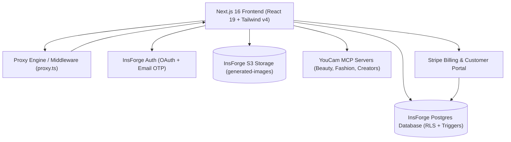

<div align="center">

  

  # BeautyAura.ai
  ### Next-Gen AI Virtual Try-On, Beauty, Hair, Skin & Creative Photo Studio

  [](https://m5294326.insforge.site)
  [](https://nextjs.org/)
  [](https://react.dev/)
  [](https://tailwindcss.com/)
  [](https://www.typescriptlang.org/)
  [](https://insforge.dev)
  [](https://stripe.com)

  <p align="center">
    <b>BeautyAura.ai</b> is a high-performance, studio-grade AI imaging suite designed for fashion brands, creators, digital models, and e-commerce platforms. Built on Next.js 16 (App Router & Turbopack), InsForge BaaS (Postgres + RLS + S3 Storage), and YouCam's streamable MCP neural engines.
  </p>

  [Explore Live App](https://m5294326.insforge.site) • [Features](#-core-ai-studios) • [Architecture](#-architecture--tech-stack) • [Quickstart](#-quickstart--local-development) • [Environment Setup](#-environment-variables) • [Deployments](#-deployment)

</div>

---

## 🌟 Overview

BeautyAura.ai brings studio-quality generative AI tools into a single, unified luxury interface. Users can upload high-resolution portraits or fashion imagery, apply specialized neural transformations with real-time Before / After interactive split comparisons, manage their credit balance, and export pristine 4K results with commercial usage rights.

---

## 🎨 Core AI Studios

BeautyAura is organized into 5 dedicated, full-featured creative studios:

### 1. 💄 AI Beauty Studio (`/dashboard/beauty`)
* **AI Look Virtual Try-On:** Instant full-glam makeover patterns with realistic lip textures, eye shadow, and complexion harmony.
* **AI Makeup Transfer:** Extract and apply makeup style from any reference editorial look onto the target portrait.
* **AI Nails Virtual Try-On:** Automatic hand-segmentation and virtual nail polish color and finish transfer.

### 2. 👗 AI Fashion Studio (`/dashboard/fashion`)
* **Virtual Clothes Try-On:** Photorealistic apparel try-on preserving fabric drape, lighting, and garment texture.
* **Luxury Bags & Accessories:** Intelligent placement of designer handbags with shadow simulation.
* **Designer Shoes Try-On:** Ankle-and-foot keypoint alignment for footwear previews.
* **Hats & Headwear:** Multi-angle headwear alignment for caps, hats, and beanies.

### 3. 💇 AI Hair & Beard Studio (`/dashboard/hair-beard`)
* **AI Hair Color Try-On:** Single-shade and multi-tone balayage / highlights with shine preservation.
* **Hairstyle Try-On:** Long waves, sleek bobs, pixie cuts, buzz cuts, and afro textures.
* **AI Beard Style Generator:** Realistic stubble, full beards, goatees, and tailored facial hair.

### 4. 🌟 AI Skin, Face & Body Studio (`/dashboard/skin-face`)
* **3D Body Reshape:** Natural silhouette sculpting with posture and perspective preservation.
* **AI Smile Enhancer:** Gentle, natural smile synthesis with photorealistic tooth whitening.
* **AI Aging Simulation:** Future and past age forecasting powered by generational facial genetics.
* **AI Abs Filter:** Realistic core definition with muscle shading that matches original lighting.

### 5. 🪄 AI Extras Studio (`/dashboard/extras`)
* **Object Removal Pro:** Interactive canvas brush with smart neural inpainting.
* **Background Removal & Studio Cutout:** One-click subject isolation with studio replacement gradients.
* **Photo Colorize:** Vibrant historical and vintage image color restoration with multi-variant options.
* **Image Extender / Outpainting:** Generative aspect expansion for social media banners, reels, and stories.

---

## ⚡ Technical Highlights & Key Features

* **Real-Time Before / After Split Slider:** Interactive split viewport enabling pixel-level comparison between original and transformed imagery.
* **Ultra-HD 4K Canvas Export:** Zero-compression downloads ready for digital ads, print media, and social platforms.
* **Proactive JWT Session Keep-Alive:** Advanced auth synchronization (`lib/auth-context.tsx`) that automatically refreshes short-lived tokens on tab focus, window visibility changes, and continuous background heartbeat intervals.
* **Zero-Flash Route Protection (`proxy.ts`):** High-speed Next.js 16 proxy/middleware verifying tokens and 7-day session cookies to prevent login flashes and redirect loops.
* **Stripe Subscription Billing & Customer Portal:**
  * Free Creator Tier (50 free credits on registration).
  * Basic Plan ($9.99/mo, 450 credits).
  * Pro Plan ($24.99/mo, 1,000 credits).
  * Self-service Stripe Customer Portal for 1-click plan upgrades, cancellations, and tax invoice receipts.
* **Idempotent Webhook Processing & Auto-Cancellation:** Backend PostgreSQL RPC and API safeguards that eliminate double-crediting and automatically cancel older parallel subscriptions when users upgrade.
* **Automatic Cloud Storage Ingestion:** Every generated asset is automatically resolved and stored in InsForge Object Storage (`generated-images` public bucket) with persistent history tracking in `public.transformations`.

---

## 🏗 Architecture & Tech Stack



| Layer | Technology | Details |
|---|---|---|
| **Frontend Framework** | [Next.js 16.4.4](https://nextjs.org/) | App Router, Turbopack, Partial Prerendering |
| **UI Library** | [React 19.3.0](https://react.dev/) | React Server Components, Server Actions |
| **Styling** | [Tailwind CSS v4](https://tailwindcss.com/) | Modern CSS variable styling, utility-first |
| **Component Kit** | [shadcn/ui](https://ui.shadcn.com/) | Base UI, Lucide React Icons |
| **Backend as a Service** | [InsForge](https://insforge.dev/) | Managed PostgreSQL, Row-Level Security, Storage, Auth |
| **AI Integration** | Streamable JSON-RPC | YouCam Beauty, Fashion & Creators MCP Servers |
| **Payments** | [Stripe](https://stripe.com/) | Subscriptions, Checkout Sessions, Webhooks |
| **Hosting & CDN** | InsForge Hosting / Vercel | Global edge network with SSL & custom domains |

---

## 📂 Project Structure

```text
ai-virtual-try-on/
├── app/
│   ├── api/
│   │   ├── auth/session/route.ts      # Secure session cookie manager
│   │   ├── beauty/generate/route.ts   # Beauty MCP endpoint + S3 caching
│   │   ├── billing/sync/route.ts      # Stripe instant fulfillment & deduplication
│   │   ├── extras/generate/route.ts   # Creators MCP endpoint (Inpainting/Cutout)
│   │   ├── fashion/generate/route.ts  # Fashion MCP endpoint (Clothes/Bags/Shoes)
│   │   ├── hair-beard/generate/route.ts # Hair & Beard MCP endpoint
│   │   ├── skin-face/generate/route.ts# Skin, Face & Body MCP endpoint
│   │   └── user/credits/route.ts      # User balance query endpoint
│   ├── auth/callback/page.tsx         # OAuth callback handler
│   ├── dashboard/
│   │   ├── beauty/page.tsx            # AI Beauty Studio View
│   │   ├── billing/page.tsx           # Billing Studio & Stripe Portal
│   │   ├── extras/page.tsx            # AI Extras Studio View
│   │   ├── fashion/page.tsx           # AI Fashion Studio View
│   │   ├── hair-beard/page.tsx        # AI Hair & Beard Studio View
│   │   ├── projects/page.tsx          # My Transformations History View
│   │   └── skin-face/page.tsx         # AI Skin & Body Studio View
│   ├── favicon.ico                    # Multi-resolution brand ICO
│   ├── globals.css                    # Tailwind CSS v4 directives & theme
│   ├── icon.png                       # 32x32 Favicon PNG
│   ├── apple-icon.png                 # 180x180 Apple Touch Icon
│   ├── layout.tsx                     # Root Layout with AuthProvider & metadata
│   ├── not-found.tsx                  # Custom luxury 404 error page
│   └── page.tsx                       # Landing page with interactive hero & pricing
├── components/
│   ├── dashboard/                     # Sidebar, top navigation, studio viewports
│   ├── landing/                       # Hero, studios showcase, comparison, pricing
│   └── ui/                            # Buttons, sliders, dialogs, badges, cards
├── lib/
│   ├── auth-context.tsx               # React Auth Context & session keep-alive
│   ├── auth-cookies.ts                # Client/server session cookie sync
│   ├── insforge.ts                    # InsForge SDK client initialization
│   ├── utils.ts                       # Classnames merge & helpers
│   └── youcam-client.ts               # Streamable HTTP JSON-RPC MCP Client
├── migrations/                        # SQL schema migrations & RLS policies
├── public/                            # Static brand assets & sample imagery
├── .env.example                       # Documented environment variables template
├── proxy.ts                           # Next.js 16 route protection engine
└── tsconfig.json                      # TypeScript configuration
```

---

## 🚀 Quickstart & Local Development

### Prerequisites
* **Node.js**: `v20.x` or `v22.x` (Recommended)
* **Package Manager**: `npm`, `pnpm`, or `yarn`
* **InsForge Account**: [InsForge Dashboard](https://insforge.dev)
* **Stripe Test Account**: [Stripe Dashboard](https://dashboard.stripe.com)

### 1. Clone the Repository
```bash
git clone https://github.com/your-username/ai-virtual-try-on.git
cd ai-virtual-try-on
```

### 2. Install Dependencies
```bash
npm install
```

### 3. Setup Environment Variables
Copy the template and fill in your keys:
```bash
cp .env.example .env.local
```
*(See [Environment Variables Reference](#-environment-variables) below for details)*

### 4. Run the Development Server
```bash
npm run dev
```
Open [http://localhost:3000](http://localhost:3000) in your browser.

### 5. Verify TypeScript & Production Build
```bash
npm run build
```

---

## 🔐 Environment Variables

| Variable | Description | Required | Scope |
|---|---|---|---|
| `NEXT_PUBLIC_INSFORGE_URL` | InsForge project API URL (e.g. `https://m5294326.ap-southeast.insforge.app`) | **Yes** | Client & Server |
| `NEXT_PUBLIC_INSFORGE_ANON_KEY` | InsForge Public Anonymous API Key | **Yes** | Client & Server |
| `INSFORGE_API_KEY` | InsForge Admin API Key (`ik_...`) with full backend privileges | **Yes** | Server Only |
| `STRIPE_TEST_SECRET_KEY` | Stripe Secret Key (`sk_test_...` or `sk_live_...`) | **Yes** | Server Only |
| `NEXT_YOUCAM_API_KEY` | YouCam AI Engine MCP API Key | **Yes** | Server Only |
| `NEXT_YOUCAM_SECRET_KEY` | YouCam RSA Secret Key for MCP handshake | **Yes** | Server Only |
| `NEXT_PUBLIC_APP_URL` | Canonical app URL (e.g. `http://localhost:3000`) | Optional | Client & Server |

---

## 🗄 Database & Backend Configuration

This project relies on **InsForge BaaS** with automated Row-Level Security (RLS):

* **`public.users`**: Contains user plan status, balance (`credits`), and Stripe customer IDs.
* **`public.transformations`**: Stores all past AI transformations with source image, output image URL, tool name, and metadata.
* **`public.billing_transactions`**: Append-only transaction ledger recording purchases, credits added, and Stripe session/invoice references.
* **`public.deduct_user_credits(amount)`**: Atomic PostgreSQL stored procedure to deduct user credits safely during generation.
* **`public.fulfill_subscription_payment(...)`**: Idempotent subscription fulfillment RPC preventing duplicate allotments.

---

## 🌐 Deployment

### Deploying to InsForge Hosting (Production)

BeautyAura can be deployed in seconds using the official InsForge CLI:

```bash
# 1. Verify project context
npx -y @insforge/cli current

# 2. Configure encrypted environment secrets on InsForge
npx -y @insforge/cli deployments env set NEXT_PUBLIC_INSFORGE_URL "https://your-project.insforge.app"
npx -y @insforge/cli deployments env set NEXT_PUBLIC_INSFORGE_ANON_KEY "anon_..."
npx -y @insforge/cli deployments env set INSFORGE_API_KEY "ik_..."
npx -y @insforge/cli deployments env set STRIPE_TEST_SECRET_KEY "sk_..."
npx -y @insforge/cli deployments env set NEXT_YOUCAM_API_KEY "sk-..."
npx -y @insforge/cli deployments env set NEXT_YOUCAM_SECRET_KEY "..."

# 3. Deploy the application
npx -y @insforge/cli deployments deploy .
```

The CLI builds the project in the cloud and outputs the live SSL-secured production URL:
**[https://m5294326.insforge.site](https://m5294326.insforge.site)**

---

## 📄 License

This project is licensed under the [MIT License](LICENSE).

---

<div align="center">
  <sub>Crafted with passion for the future of AI fashion and generative aesthetics.</sub>
</div>
